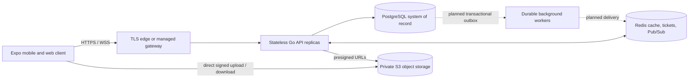

# ChatApp Release Readiness

**Reviewed:** 2026-11-13  
**Scope:** Current Go API, PostgreSQL schema, Redis integration, S3-compatible media, and Expo client.

## Target architecture

PostgreSQL remains authoritative for accounts, social relationships, posts, and messages. Redis is suitable for short-lived tickets, caches, and realtime fanout; its Pub/Sub delivery is ephemeral. Media objects stay private and clients use expiring signed URLs. The Compose object store is for local development; production should use a managed S3-compatible service with TLS, private bucket policy, lifecycle rules, and credentials from workload identity or a secret manager.

## Hardening completed in this pass

- Added startup configuration validation, PostgreSQL TLS controls, bounded connection pools, readiness/liveness endpoints, and graceful shutdown.
- Replaced WebSocket identity in the query string with short-lived, single-use Redis tickets; restricted browser origins and removed query strings from request logs.
- Restricted personnel writes and redacted private profile fields. Added private follow requests, block-aware visibility checks, and visibility checks for saved posts, post comments, search, and feeds.
- Replaced unsafe dynamic SQL filter construction with whitelisted identifiers/operators and parameterized values.
- Added actual device-photo upload, private presigned media access, upload ownership/size/type checks, and image decode bounds.
- Connected the API to Redis-backed message fanout and wired media/search controllers. Restored the Expo manifests to version control and added secure token storage on native clients.
- Replaced the archived MinIO development image with a pinned SeaweedFS S3-compatible development service; production bucket creation now fails closed. Updated Redis and NGINX image tags.

## Release gates still open

1. **Build and behavior evidence:** Run Go unit/integration tests, the API build, Expo production builds, and migration up/down rehearsals in CI. These were not run in this pass. Docker Compose validation could not run because Docker is unavailable in the current environment.
2. **Dependency security:** The current `npm audit --omit=dev` still reports 3 high, 11 moderate, and 1 low advisory in the Expo/Metro dependency tree. Resolve with Expo-compatible patched versions or reviewed overrides, then validate production builds; do not use a forced SDK downgrade as the fix.
3. **Production infrastructure:** Supply real high-entropy secrets, verified database TLS and CA material where needed, Redis authentication/TLS, and a private TLS-enabled S3 endpoint. Configure browser CORS for the production app origin and `PUT`/`GET`; set a reachable S3 endpoint for mobile clients. The Compose stack and sample `.env` are development-only.
4. **Reliable asynchronous work:** The media processor still uses a bounded in-process queue, and Redis Pub/Sub can lose fanout events while subscribers are disconnected. Persist jobs and delivery events through the existing database/outbox path, add retries and dead-letter handling, and make consumers idempotent before relying on them for delivery guarantees.
5. **Abuse and operations:** Add distributed rate limits for login, registration, search, follow requests, and upload initiation; enforce per-user storage quotas and staging-object cleanup. Add metrics, traces, structured redacted logs, alerting, backup/restore drills, and a production runbook.
6. **Release supply chain:** Pin production images by digest, scan container and Go dependencies in CI, and verify migration compatibility with the deployed PostgreSQL version.

## Delivery plan

### P0 — Before public launch

- Close the build/test and migration gates above.
- Fix all high-severity mobile dependency advisories without downgrading the Expo SDK.
- Deploy against managed TLS-enabled PostgreSQL, Redis, and private object storage; verify the app’s signed upload/download path from a real device and the production web origin.
- Configure rate limits, quotas, staging cleanup, backups, alert thresholds, and an on-call rollback procedure.

### P1 — First reliability release

- Wire a transactional outbox for message, follow, and notification events.
- Move media processing to durable workers with retries, idempotency, image/video variants, metadata/EXIF stripping, and malware scanning.
- Add refresh-token rotation, session/device revocation, account recovery, and audit events for sensitive account changes.
- Add push notifications through APNs/FCM with preferences and delivery state.

### P2 — Product and trust features

- Add user reporting, moderation queues, spam detection, and appeal workflows.
- Add granular audience controls such as close-friends lists and per-post audience selection.
- Add creator analytics and richer discovery only after event tracking, privacy rules, and retention policies are defined.

## Architectural decisions to preserve

- Keep authorization and visibility checks in services/repositories, not only in client navigation.
- Keep private media in private buckets; use short-lived URLs and never fall back to a public object URL on signing errors.
- Treat Redis as replaceable acceleration/fanout infrastructure, not the durable record of a user action.
- Keep migrations backward-compatible across rolling API deployments; use expand/migrate/contract for schema changes.
